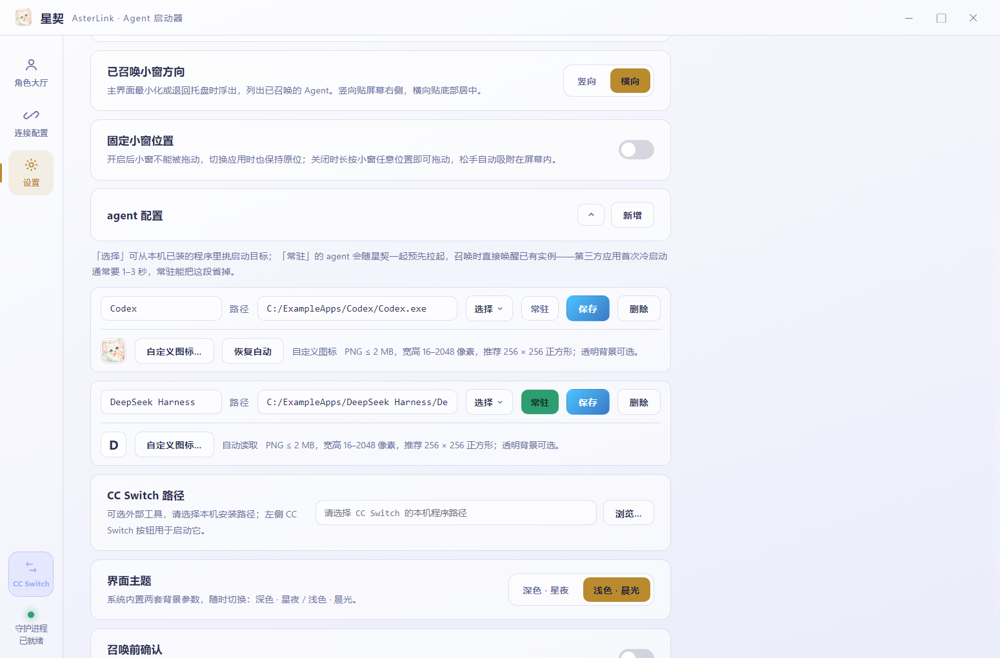

# 自定义 AI 形象

DeepSeek、MiMo 默认使用对应角色立绘，其他内置角色使用带有“可自定义形象”的神秘剪影。在该角色的「编辑形象」中可以替换为自己的透明立绘，也可以通过「新增形象」创建独立角色。

因版权与授权范围限制，项目未完整提供全部 AI 娘形象。需要其他 AI 娘形象的用户，可前往 B 站作者 [ZipZipPipe](https://space.bilibili.com/4168597) 处自行获取，并遵守作者对具体素材的使用说明与许可要求。

## 添加与使用

1. 打开「连接配置」，点击「新增形象」。
2. 填写形象名称，点击「选择透明 PNG」导入立绘。应用会从立绘自动推荐光晕主题色，仍可手动调整。
3. 检查预览，点击「保存形象」。新形象默认加入大厅。
4. 展开该形象，勾选要绑定的 Agent，并按需配置召唤动画和台词。Agent 的程序路径在「设置」中配置。

## 光晕主题色

首次导入时会自动推荐主色：在本机缩小取样，忽略透明、近透明、过黑、过白及低饱和度像素，再选择主要色系并调整亮度。黑白灰立绘会使用默认紫色。

手动调色后，更换立绘会保留手动颜色；点击「使用立绘推荐色」可采用当前图片的推荐色，并恢复后续导入时的自动推荐。颜色选择会随形象保存，重启后保留。已有形象未记录配色方式时按手动颜色处理，避免覆盖原有配色。图片与分析结果均保存在本机。

## 图片要求

| 项目 | 要求 |
| --- | --- |
| 格式 | PNG，包含透明背景；不支持 JPG、SVG、GIF 或仅改扩展名的文件 |
| 文件大小 | 不超过 10 MB（10 × 1024 × 1024 字节） |
| 尺寸 | 宽、高分别为 256–4096 像素 |
| 推荐构图 | 竖版全身，约 800 × 1600 像素；人物居中，四周少留白，头脚完整 |
| 背景 | 先抠图再导入；白底或画进图片里的棋盘格不是真透明背景 |
| 内容 | 含有可见人物，不能完全透明；请使用你有权使用的图片 |

导入后预览区域会显示透明棋盘格。应用不会自动去除背景；尺寸合格但构图偏横或留白较多的图片仍可导入，人物可能显示较小。超过 2048 像素的图片会等比缩小保存。

## 编辑、删除与保存

在形象的连接配置中点击「编辑形象」，可以修改名称、主题色或替换立绘。内置形象可以「恢复默认」；自定义形象可以「删除形象」，同时从大厅移除，不影响 Agent 程序和原始图片。

立绘会复制到应用数据目录，仅供本机使用；原始文件随后被移动或删除不会影响已导入的形象。形象和 Agent 绑定会随本地配置保存，重启后继续使用。备份或迁移时应同时保留应用数据目录中的配置与立绘，不能只复制配置文件。

## 自定义应用图标

角色立绘与应用图标分开设置。进入「设置 → agent 配置」，为对应 Agent 点击「自定义图标…」选择 PNG，会立即保存并同步到大厅及小窗。

图标要求：PNG、不超过 2 MB，宽高分别为 16–2048 像素，推荐 256 × 256 正方形，可带透明背景。图片会按比例缩小到最长边 128 像素并保存在本机，移动原文件不影响使用；改名或重启后继续保留。自定义图标优先于自动读取，点击「恢复自动」可清除该设置。

