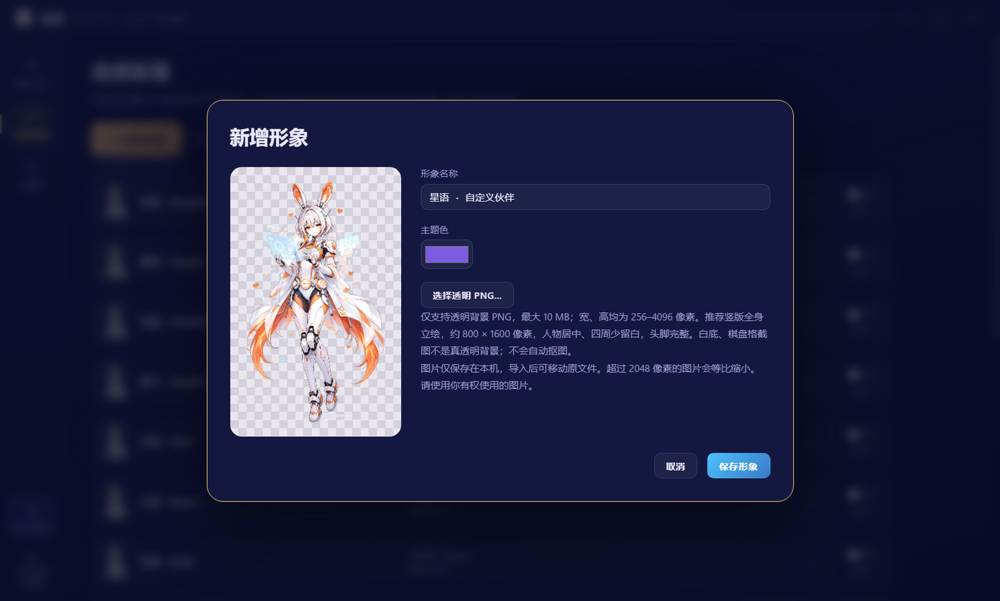

# 自定义 AI 形象

## 添加与使用

1. 打开「连接配置」，点击「新增形象」。
2. 填写形象名称，选择主题色，点击「选择透明 PNG」导入立绘。
3. 检查预览，点击「保存形象」。新形象默认加入大厅。
4. 展开该形象，勾选要绑定的 Agent，并按需配置召唤动画和台词。Agent 的程序路径在「设置」中配置。

## 图片要求

| 项目 | 要求 |
| --- | --- |
| 格式 | PNG，包含透明背景；不支持 JPG、SVG、GIF 或仅改扩展名的文件 |
| 文件大小 | 不超过 10 MB（10 × 1024 × 1024 字节） |
| 尺寸 | 宽、高分别为 256–4096 像素 |
| 推荐构图 | 竖版全身，约 800 × 1600 像素；人物居中，四周少留白，头脚完整 |
| 背景 | 先抠图再导入；白底或画进图片里的棋盘格不是真透明背景 |
| 内容 | 含有可见人物，不能完全透明；请使用你有权使用的图片 |

导入后预览区域会显示透明棋盘格。应用不会自动去除背景；尺寸合格但构图偏横或留白较多的图片仍可导入，人物可能显示较小。超过 2048 像素的图片会等比缩小保存。

## 编辑、删除与保存

在形象的连接配置中点击「编辑形象」，可以修改名称、主题色或替换立绘。内置形象可以「恢复默认」；自定义形象可以「删除形象」，同时从大厅移除，不影响 Agent 程序和原始图片。

立绘会复制到应用数据目录，仅供本机使用；原始文件随后被移动或删除不会影响已导入的形象。形象和 Agent 绑定会随本地配置保存，重启后继续使用。备份或迁移时应同时保留应用数据目录中的配置与立绘，不能只复制配置文件。
