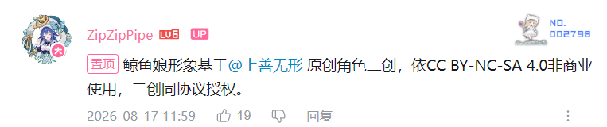

# DeepSeek 鲸鱼娘立绘署名与许可

适用文件：`app/art/Deepseek.png`，以及文档截图中使用该立绘的部分。

- 鲸鱼娘原始角色：上善无形（上善）。[Bilibili 主页](https://space.bilibili.com/4456176)、[Pixiv 作者页](https://www.pixiv.net/users/62155430)。
- 加入 DeepSeek 元素的女仆形象二次设计：ZipZipPipe（zipzip）。[Bilibili 主页](https://space.bilibili.com/4168597)、[Pixiv 作者页](https://www.pixiv.net/users/18604994)、[《AI娘化》作品页](https://www.pixiv.net/artworks/148186519)。
- 本项目立绘由维护者从原设计素材归档提供，为透明 PNG；在应用中等比缩放并与界面组合展示。原始下载页面未随历史归档保存，不将上述设计参考页表述为已核验的该 PNG 原图链接。

该角色设计及适用的立绘改编部分遵循 [CC BY-NC-SA 4.0](https://creativecommons.org/licenses/by-nc-sa/4.0/deed.zh-hans)：保留署名、非商业使用、改编后相同方式共享。该素材不适用项目代码的 MIT 许可。原作者及二创作者不为本项目背书，亦不代表 DeepSeek 官方授权。

维护者保存的 ZipZipPipe 授权声明（2026-08-17）说明：鲸鱼娘形象基于上善无形原创角色二创，依 CC BY-NC-SA 4.0 非商业使用，二创同协议授权。

仓库中的其他角色和应用标识不能自动套用该项授权，分别见 [角色形象说明](ARTWORK.md)。
