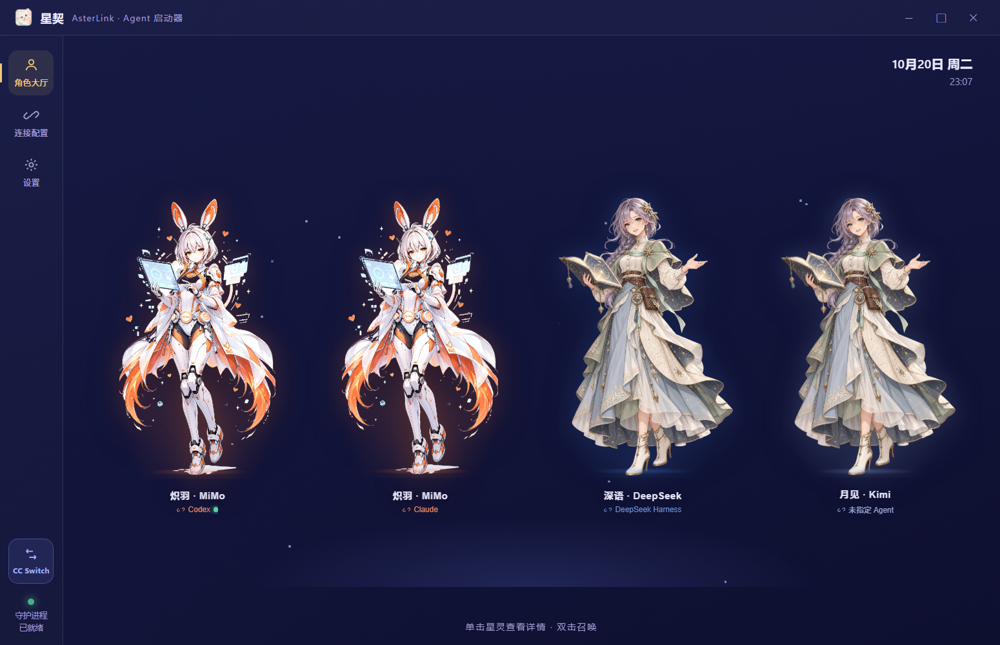
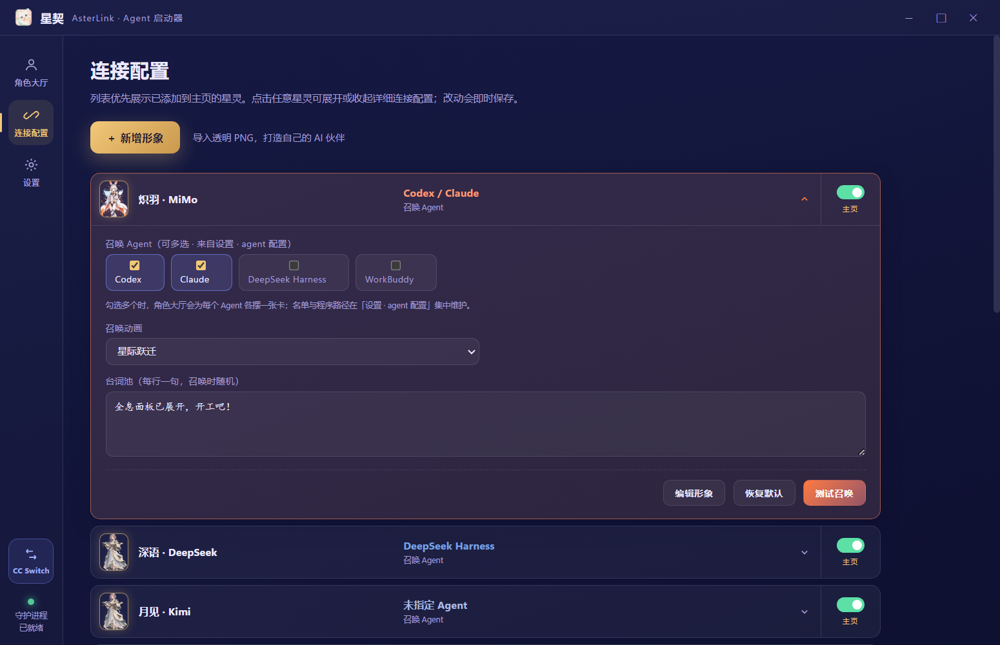
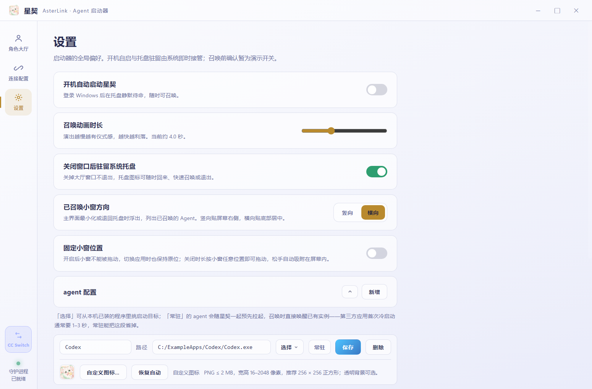

# AsterLink Project Overview

A character-based desktop launcher for AI companions

AsterLink turns frequently used AI applications into companions you can summon from a shared desktop hub. An anime character roster, summoning animations, and a compact floating launcher bring a more personal experience to opening and switching between AI tools.

> Project snapshot: October 20, 2026 · Source version 0.3.7 · Currently targets Windows. The public source edition uses AsterLink / 星契 branding, MiMo and Lumi characters, and a fox app icon. Legacy internal installation identifiers and the configuration path remain for upgrade compatibility. Windows x64 installer and portable editions are available from GitHub Releases.



## 01 Purpose and use cases

AsterLink is designed for people who regularly use several AI desktop tools, such as coding assistants and general-purpose chat applications. It brings their launch points together, associates tools with recognizable characters, displays process status, and keeps summoned tools accessible after the main window is hidden.

A typical workflow starts by registering local application paths for tools such as Codex and Claude, then assigning them to characters. The user summons a tool from the roster and later returns to it through the floating launcher. Characters are configurable launch mappings; a character name does not establish a model integration.

The current product provides local application launching and reopening. The reviewed repository does not implement model API calls, a unified chat interface, conversation aggregation, or automated multi-agent orchestration. Its CC Switch button launches an external provider-switching utility; provider configuration belongs to that utility.

## 02 Implemented experience

- Character roster: character artwork, quotes, and process indicators (the public edition includes MiMo and Lumi and does not bundle third-party badges). A single click opens details; a double click starts the summoning flow. Cards represent character–agent pairs and resize with the window.

- Connection configuration: assign multiple agents to one character, select which characters appear on the home roster, and configure animation styles and quote pools. The initial home roster is empty until the user adds characters.

- Application registry: maintain agent names and local paths in one settings page. A candidate scanner and file picker help locate applications without repeating paths in every character configuration.

- Windows launch handling: separate paths cover GUI applications, console programs, shortcuts, protocol URLs, and WindowsApps targets. Compatibility still depends on each target application.

- Process status: the main process polls the Windows process list approximately every five seconds and pushes changes to the interface. “Running” means a matching process exists; it does not confirm service readiness or foreground visibility.

- Desktop presence: a tray menu provides quick launch, restore, and exit actions. The floating launcher supports horizontal and vertical layouts, dragging, and a position lock. Reopening behavior relies on how the target handles another launch request.

- Preferences and prewarming: selected applications can be launched in a minimized state in advance. Login startup, light and dark themes, animation duration, and close-to-tray behavior are configurable. Targets may ignore minimized startup.



## 03 Technology stack

| Layer | Technology and implementation | Responsibility |
| --- | --- | --- |
| Desktop runtime | Electron ^33.0.0 | Main window, transparent floating window, tray, dialogs, single-instance behavior, and login startup |
| Interface | Vanilla HTML, CSS, and JavaScript | Roster, forms, themes, animations, and responsive layout; no React or Vue framework |
| System layer | Electron’s Node.js runtime and CommonJS | fs, path, and child_process for configuration files, process launches, and system commands |
| Process communication | contextBridge and IPC | Limited preload APIs, with different capability sets for the main and floating windows |
| Windows integration | tasklist.exe, cmd.exe, and Electron shell | Process enumeration, console launch, shortcut resolution, protocols, and store application opening |
| Persistence | userData/config.json | Characters, agent registry, and preferences; backup before configuration schema upgrades |
| Build and distribution | npm, electron-builder ^26.15.3, and NSIS | Configured Windows x64 installer and portable outputs; no build executed for this report |
| Visual assets | PNG artwork, agent icons, and a multi-size ICO | Character presentation, app identity, system tray, and installer icons |

Dependency ranges above come from app/package.json and are not a statement of the exact installed versions. The launcher centers on local files and process management, without requiring a separate application backend or database. Network access, accounts, and model services used by launched tools remain those tools’ responsibility.

## 04 Architecture and data flow

```text
User selects a character
  → renderer.js resolves its agent mapping and plays the animation
  → preload.js sends a launch request through IPC
  → main.js launches or reopens the target using Windows facilities
  → summoned entries update the tray and floating launcher
  → tasklist polling pushes process status back to the interface

Settings change → IPC → config-store.js → userData/config.json
```

app/main.js owns windows, system integration, launching, and process status. app/renderer.js owns character presentation, interaction, and summoning effects. The two preload scripts bridge their respective windows to the main process. config-store.js reads and writes configuration and backs up older schemas. mini.html, mini.css, and mini.js implement the floating launcher.

Both windows enable contextIsolation and disable nodeIntegration. The interface therefore does not receive unrestricted Node.js access. IPC payload validation, content security policy, and launch-target constraints remain areas for improvement.



## 05 Getting started

- Install dependencies in the app directory and run npm start. If dependencies are already installed, start the application directly. Opening index.html in a browser provides a visual demonstration only.

- Register each target application in Settings. Use the candidate selector or browse for a local executable.

- Open Connection Settings, assign agents to characters, and enable their home-roster visibility.

- Return to the roster to inspect or summon a character. After a successful summon, the main window hides and the floating launcher provides access to summoned tools.

- Enable resident prewarming, login startup, or the floating-window position lock as needed. Prewarming starts the selected third-party applications.


## 06 Future optimization directions

The following are proposals based on the current implementation, not a committed release schedule; brand alignment and release-asset separation are now complete. Reliable launching and understandable waiting states should precede broader customization and automation.

| Priority | Direction | Proposed change and benefit |
| --- | --- | --- |
| P0 | Launch reliability | Normalize surrounding quotes and validate targets; the current entry point only trims whitespace. Improve shortcut argument parsing and cover GUI, console, and store-app cases with actionable errors. |
| P0 | Configuration and trust boundaries | Use temporary files and atomic replacement for configuration, validate its structure, and surface save and backup failures. Strengthen IPC validation, launch-target constraints, and CSP. |
| P1 | Waiting experience | The current animation submits the launch request after roughly 4100 × animScale milliseconds. Offer full-animation and quick-launch modes; evaluate concurrent animation and launching after a product decision. Measure request dispatch separately from target readiness. |
| P1 | Status and wake accuracy | Supplement executable-name matching with paths, PIDs, or application adapters. Distinguish starting, running, and failed states, with dedicated detection strategies for protocols and store apps. |
| P1 | Brand and repository consistency | Apply AsterLink across UI, tray, package metadata, and documentation while preserving existing userData during migration. Clarify the maintenance relationship between root main.js and app/main.js; separate capture scripts, historical images, and release assets. |
| P1 | Regression coverage and diagnostics | Cover empty rosters, multiple agents, configuration migration, quoted paths, multi-monitor dragging, and launch failures. Add exportable local diagnostic logs. |
| P2 | Customization and accessibility | Consider character-pack import/export, configuration backup and restore, search, keyboard shortcuts, reduced motion, focus navigation, and smaller icon variants. Verify artwork and trademark permissions before distribution. |
| P2 | Adapters and additional platforms | Define an application adapter layer and launch-capability model before evaluating macOS or Linux. Cross-platform support requires replacements for tasklist, cmd, Windows shortcuts, and login integration. |
| Explore | Workflow features | Investigate workspace groups, opening tool sets, and recent items. Future model calls or agent orchestration would need separate credential, task-state, and permission designs. |

## 07 Scope and evidence

Screenshots were freshly rendered from the current Electron pages with isolated demonstration data from scripts/_intro-shot.cjs and scripts/_intro-mini.cjs. Paths, process states, and roster contents are examples, not proof of installed applications or measured launch performance. Screenshots use the public edition’s MiMo and Lumi artwork and updated brand; historical third-party illustrations and logos are not included.

This overview is based on app/package.json, main.js, renderer.js, preload.js, preload-mini.js, config-store.js, mini.js, styles.css, and README. Descriptions follow the current source. Successful process creation and full target readiness are different states, and no reproducible launch-performance benchmark is provided.

